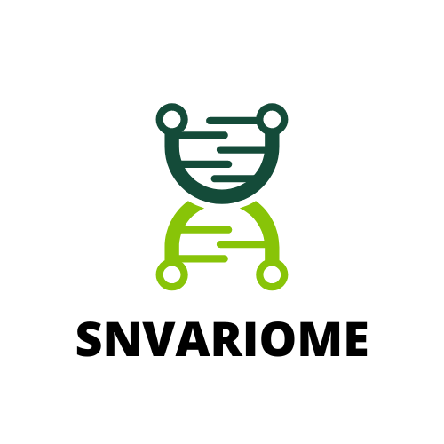

<p align="center">
  
</p>

# SNVariome

SNVariome is a mechanism-aware, variant-centered interactome. It integrates
clinical variant records, molecular mechanism annotations, protein structure,
protein-protein interactions, drug-gene relationships, phenotype context, and
perturbational signatures to support how a protein-altering variant may affect
molecular function and interaction networks.

The scientific premise is that pathogenic variants acting through
gain-of-function, loss-of-function, dominant-negative, and haploinsufficiency
mechanisms can show different structural and interaction patterns. SNVariome
therefore keeps direct measurements, curated classifications, computational
predictions, contextual associations, conflicts, and missing evidence visibly
distinct. The integrated evidence is intended to support variant
interpretation and prioritization. It is not a new pathogenicity classifier.

## Target evidence layers

The complete product will connect seven evidence layers around a resolved
variant:

1. **Clinical variant evidence:** ClinVar classification, review status,
   condition, and clinical context.
2. **Molecular mechanism:** Curated GOF, LOF, dominant-negative, and
   haploinsufficiency assertions.
3. **Protein structure:** Stability effects, domains, functional sites,
   interfaces, and Extent of Disease Clustering (EDC) context.
4. **Protein interactions:** Wild-type and mutant interaction measurements or
   clearly labeled predictions.
5. **Drug-gene relationships:** Traceable associations that do not imply a
   treatment recommendation.
6. **Phenotypes and pathways:** HPO terms, disease associations, and pathway
   context.
7. **Perturbational signatures:** SigCom LINCS results presented as hypotheses,
   not evidence of variant rescue.

These layers form a more complete interactome than a binary list of protein
partners because they preserve the allele, mechanism, structural setting,
experimental context, and provenance of each relationship.

## Current application

The current application is the first breast-cancer validation slice. It
supports three curated PIK3CA variants:

- `p.Glu545Lys` (`p.E545K`)
- `p.Met1043Val` (`p.M1043V`)
- `p.His1047Arg` (`p.H1047R`)

A persistent search sidebar and five application views share one versioned
evidence bundle:

1. **Overview** resolves supported genomic, transcript, and protein notations
   and provides a selectable table of curated variants.
2. **Evidence** presents identity, mechanism, structural context, phenotypes,
   hypotheses, and explicitly missing evidence.
3. **Interactions** provides a searchable table and a record-level evidence
   inspector.
4. **Network** displays a focused allele-centered interaction graph with
   selectable evidence-aware edges.
5. **Sources** lists source records and exports the selected variant with all
   sources it references.

This release demonstrates the evidence architecture and allele-specific
interaction workflow. It does not yet search the full GOF/LOF dataset, populate
ClinVar evidence, calculate EDC, recommend drugs, or infer an effect for
variants outside the PIK3CA demonstration bundle.

## Evidence scope

The interaction examples are a focused qualitative subset reconstructed from
Figure 3C of Kim et al. The study compared wild-type and mutant PIK3CA affinity
purification mass spectrometry results in MCF7 cells. Exact quantitative effect
sizes are not included because the corresponding supplementary table was not
available during curation. The records retain this limitation rather than
estimating values from the figure.

The repository retains five original source artifacts under `data/source/`:

| File | Retained content |
| --- | --- |
| `goflof_ClinVar_v062021.csv` | 5,085 variant-level GOF or LOF labels |
| `allels_ProteinList.csv` | Allele ID to gene-symbol mappings |
| `edc_dist.csv` | Gene-level inheritance, mechanism, effect, and EDC values |
| `proteins.csv` | Gene symbols represented in the original analysis |
| `proteins_interactome.csv` | Protein-pair interaction edge list |

The GOF/LOF table is associated with the resource described by Bayrak et al.
Gerasimavicius et al. used a Bayrak et al. variant-level mechanism dataset as
an independent validation set when studying mechanism-specific structural
effects. These retained files must undergo identifier, release-provenance,
licensing, and redistribution audits before their records are migrated into
the public evidence bundle.

The Gerasimavicius et al. study also provides the structural rationale for EDC.
EDC is a protein-level measure of how known disease-associated residues cluster
in three-dimensional space. It is contextual evidence, not a per-variant
pathogenicity score. A high EDC may support a non-LOF pattern, but it cannot by
itself distinguish GOF from a dominant-negative mechanism.

Each assertion is labeled with one of the evidence classes defined in
[`PLAN.md`](PLAN.md): direct experimental, curated clinical, computational
prediction, contextual association, conflicting, or missing. An unchanged
measured interaction is not treated as missing evidence.

## Project structure

The application follows Rhino's modular organization:

```text
app.R                         Rhino entry point
app/main.R                    Top-level UI and server composition
app/logic/                    Evidence, normalization, and network logic
app/view/                     Five search and dashboard-view modules
app/data/pik3ca/              Versioned curated evidence fixture
data/source/                  Retained source datasets awaiting migration
schema/                       JSON Schema for evidence bundles
tests/testthat/               Contract, logic, and module tests
dependencies.R               Runtime and test dependency manifest
renv.lock                     Reproducible R dependency lockfile
```

Rhino starts the application from `app/main.R`.

## Local setup

Install R 4.5.1, clone the repository, and run:

```r
install.packages("renv")
renv::restore()
shiny::runApp(".")
```

`renv::restore()` installs the exact package versions recorded in `renv.lock`.
Use `renv::snapshot()` only after deliberately changing `dependencies.R` and
reviewing the resulting lockfile diff.

## Validation

Run the focused test suite from the repository root:

```r
testthat::test_dir("tests/testthat")
```

The tests validate the curated bundle, equivalent aliases for all three
variants, unmatched-input handling, missing-data semantics, network record
consistency, duplicate partners, schema-valid downloads, and search-module
reactivity.

## Container

Build and run the application with:

```bash
docker build -t snvariome .
docker run --rm -p 3838:3838 snvariome
```

Then open `http://localhost:3838`.

## References

Kim M, Park J, Bouhaddou M, et al. A protein interaction landscape of breast
cancer. *Science*. 2021;374(6563):eabf3066.
[doi:10.1126/science.abf3066](https://doi.org/10.1126/science.abf3066).

Gerasimavicius L, Livesey BJ, Marsh JA. Loss-of-function, gain-of-function and
dominant-negative mutations have profoundly different effects on protein
structure. *Nature Communications*. 2022;13:3895.
[doi:10.1038/s41467-022-31686-6](https://doi.org/10.1038/s41467-022-31686-6).

Bayrak CS, et al. Identification of discriminative gene-level and protein-level
features associated with pathogenic gain-of-function and loss-of-function
variants. *American Journal of Human Genetics*. 2021;108:2301-2318.
[doi:10.1016/j.ajhg.2021.10.007](https://doi.org/10.1016/j.ajhg.2021.10.007).

Full provenance, retrieval dates, source locations, and redistribution notes
are stored in the evidence bundle and displayed in the app.
